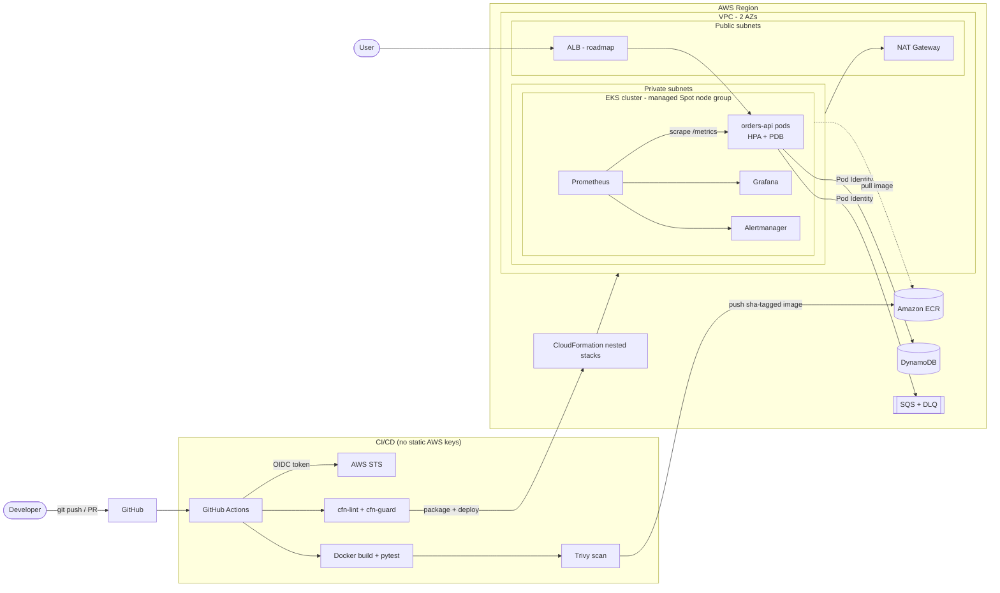

# Production-Style Microservice Platform on AWS EKS

A containerised service running on **Amazon EKS**, with 100% of the AWS infrastructure defined in **CloudFormation**,
a keyless **GitHub Actions** CI/CD pipeline (OIDC), image and policy scanning, and a **Prometheus + Grafana** observability stack.

> Built to demonstrate cloud engineering (IaC, CI/CD, Kubernetes, observability) and solutions architecture
> (trade-offs, security, cost, Well-Architected alignment).

## Architecture



## What's in the box

| Area | Implementation |
|---|---|
| **IaC** | CloudFormation nested stacks: `network`, `eks`, `app` + a long-lived `bootstrap` stack |
| **Compute** | EKS (API-only auth with access entries), managed node group on **Spot**, core add-ons |
| **Identity** | GitHub → AWS via **OIDC** (branch-scoped trust), **EKS Pod Identity** for workloads, OIDC provider for IRSA-based charts |
| **CI** | cfn-lint, cfn-guard policy-as-code, pytest, multi-stage non-root Docker build, **Trivy** gate |
| **CD** | Manual, cost-aware workflow: build → (optional) infra → (optional) app deploy; separate teardown workflow |
| **Observability** | kube-prometheus-stack, custom app metrics (rate / errors / latency histogram), alert rules |
| **Resilience** | HPA, PodDisruptionBudget, zone topology spread, readiness/liveness probes |
| **Data** | DynamoDB (on-demand, SSE, PITR), SQS with dead-letter queue |
| **Security** | Private worker nodes, least-privilege IAM, ECR scan-on-push + immutable tags, S3 public access block, pod security context |

## Repository layout

```
.
├── app/orders-api/            # Flask service, Dockerfile, tests, Prometheus metrics
├── infra/
│   ├── cloudformation/        # bootstrap, main (parent), network, eks, app
│   └── guard/rules.guard      # cfn-guard policy rules
├── k8s/orders-api.yaml        # Deployment, Service, HPA, PDB, ServiceMonitor
├── monitoring/                # Helm values + PrometheusRule alerts
├── scripts/                   # deploy.sh / teardown.sh
├── docs/ADRs.md               # Architecture decision records
└── .github/workflows/         # ci, deploy, teardown
```

## Getting started

### Prerequisites
AWS account, AWS CLI v2, `kubectl`, `helm`, a GitHub repo for this code.

### 1. Bootstrap (once, cheap, keep it)

```bash
aws cloudformation deploy \
  --template-file infra/cloudformation/bootstrap.yaml \
  --stack-name eks-portfolio-bootstrap \
  --capabilities CAPABILITY_NAMED_IAM \
  --parameter-overrides GitHubOrg=<your-user> GitHubRepo=<your-repo>
  # add CreateOidcProvider=false if the account already has a GitHub OIDC provider

aws cloudformation describe-stacks --stack-name eks-portfolio-bootstrap --query "Stacks[0].Outputs"
```

### 2. Configure GitHub
Repo → Settings → Secrets and variables → Actions → **Variables**:
`AWS_ROLE_ARN` (from outputs), `ARTIFACTS_BUCKET` (from outputs), `AWS_REGION` (e.g. `us-east-1`).

### 3. Deploy
**Via pipeline:** Actions → *Deploy* → Run workflow → tick `deploy_infra` (wait ~15 min), then run again with `deploy_app`.
**Or locally:** `./scripts/deploy.sh <artifacts-bucket> <deploy-role-arn>`

### 4. Explore

```bash
kubectl -n app get pods,hpa
kubectl -n monitoring port-forward svc/kube-prometheus-stack-grafana 3000:80
# password: kubectl -n monitoring get secret kube-prometheus-stack-grafana -o jsonpath='{.data.admin-password}' | base64 -d
kubectl -n app port-forward svc/orders-api 8080:80
curl -XPOST localhost:8080/orders -H 'content-type: application/json' -d '{"item":"book"}'
```

### 5. Tear down (stop the billing!)
Actions → *Teardown* (type `destroy`), or `./scripts/teardown.sh`. The bootstrap stack costs ~nothing and can stay.

## Cost

Approximate us-east-1 on-demand pricing, **verify current prices in the AWS Pricing Calculator**:

| Item | ~Cost |
|---|---|
| EKS control plane | $0.10/hr |
| NAT Gateway (1) | $0.045/hr + data |
| 2 × t3.medium Spot | ~$0.03/hr total (varies) |
| **Total while running** | **~$0.17/hr (~$4/day)** |
| DynamoDB, SQS, ECR (small), S3 | free-tier range |

Cost controls built in: Spot nodes, a single NAT, a free S3 gateway endpoint, short Prometheus retention, no load balancer by default,
standard-support-only Kubernetes versions, and a one-click teardown.

## Well-Architected mapping

| Pillar | Decision |
|---|---|
| Operational excellence | Everything as code, pipeline-driven, alerts + dashboards, teardown automation |
| Security | Keyless CI (OIDC), Pod Identity, private nodes, image scanning, policy-as-code, encrypted data stores |
| Reliability | Multi-AZ subnets, HPA, PDB, DLQ, managed node group rolling updates |
| Performance efficiency | Right-sized requests/limits, HPA, multiple Spot instance types |
| Cost optimisation | Spot, single NAT (documented trade-off), on-demand DynamoDB, lifecycle policies |
| Sustainability | Ephemeral environment, autoscaling, no idle infrastructure |

## Roadmap
- [ ] AWS Load Balancer Controller + ACM + Route 53 + WAF
- [ ] External Secrets Operator + Secrets Manager
- [ ] k6 load test with Grafana autoscaling screenshots
- [ ] Karpenter, Loki logs, OpenTelemetry tracing
- [ ] Alertmanager → SNS/Slack routing
- [ ] Worker service consuming SQS

## Screenshots


## Lessons learned / what broke
